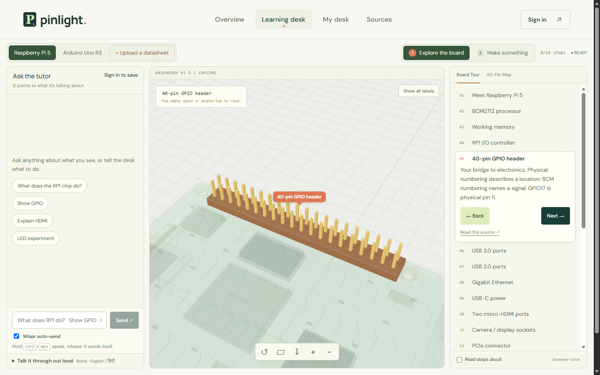
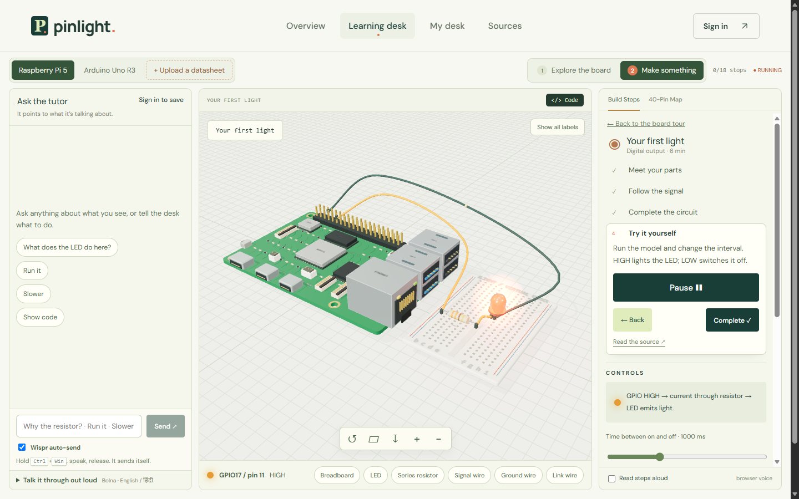

# Pinlight


**Understand the board. Follow the connection. See what changes.**

Pinlight turns electronics PDFs into source-linked learning journeys, alongside prepared Raspberry Pi 5 and Arduino Uno R3 lessons. It brings a selectable 3D board, guided circuit activities, reference code, a source-linked AI tutor and a consent-gated voice tutor into one workspace.

[Explore Pinlight](https://pinlight.afreenorbit.tech/)



## Why it matters

A beginner's first circuit can mean switching between a datasheet, a pinout, wiring instructions and a code example. Pinlight keeps those pieces together: select a part, inspect its pins, follow a connection and ask why it works. The goal is to make starting electronics more approachable and let learners spend their effort understanding the circuit.

Today, the catalogue includes **2 boards, 5 experiment types per board and 20 guided experiment steps per board**. The Pi has 18 selectable board stops and a 40-position pin inspector that distinguishes physical pin numbers from BCM GPIO numbers. These are coverage counts; learning gains and time savings have not yet been measured.

## What you can do

- Explore the board in 3D, select parts and follow explanations linked to reference sources.
- Try **Blink an LED**, **Read a button press**, **Set the RGB balance**, **Tune a piezo tone** and **Position a servo**. Change controls and inspect the matching Python or Arduino reference code.
- Ask the tutor about the current lesson. Mastra orchestrates `gpt-oss-120b` through Groq; the server validates returned source IDs and component targets. A labelled curated guide is available when live AI is unavailable.
- Talk it through out loud in English or Hindi. The voice tutor is consent-gated, capped at three minutes, and shares the chat command handler: it can move the scene, navigate lessons and run the teaching previews.
- Upload an electronics PDF to create a persistent processing job, extract device specifications with source citations, explore approximate 3D components, review pins and dimensions, try ideal voltage-divider or capacitor-charge experiments, and search for related manufacturer references through SerpApi.
- Sign in with Auth0 to save documents, chats, journeys and progress in My desk. Owner-scoped row-level security and private storage keep each account's files separate. Guests can explore; cloud saving needs an account.



## How it works

Pinlight is split into a browser desk, a Node API and a small set of provider integrations:

- **Browser desk:** React 19 and Vite, with Three.js for the original board illustrations. The desk owns the 3D scene, guided steps, code preview and chat.
- **API:** Node 24 on Render. It verifies Auth0 tokens, assembles server-owned lesson snapshots, runs the Mastra tutor, validates answers, processes PDFs, proxies SerpApi and mints Bolna voice sessions.
- **Typed tutor:** Mastra orchestrates `openai/gpt-oss-120b` through Groq. The server sends a bounded lesson snapshot and a strict output schema, then checks every returned evidence ID and component target before the answer reaches the scene. The browser cannot inject its own prompt text.
- **Speech:** one Speak control in chat. Wispr inserts dictated text, and Bolna reads the chat response using ElevenLabs English or Sarvam Hindi. Stop dictation switches to continuous Bolna listening with Deepgram transcription. An authenticated OpenAI-compatible bridge sends each transcript to the same desk handler as typed chat; commands update the scene, questions use the existing Mastra/Groq tutor, and the actual result returns to Bolna for speech. Continuous sessions are capped at three minutes.
- **ElevenLabs access:** Bolna is the orchestrator, not a model owner. Its preferred-model bundle includes ElevenLabs `eleven_turbo_v2_5`, so Pinlight uses Bolna's provider integration and does not need a direct `ELEVENLABS_API_KEY` for the standard Angelica voice. A cloned or custom voice would require connecting your own ElevenLabs account in Bolna.
- **Data:** Supabase provides Postgres, row-level security and private document storage. Auth0 provides hosted sign-in and audience-bound API tokens. Local development uses SQLite for documents and processing jobs.
- **Documents:** PDF.js extracts text with coordinates, Tesseract.js handles image-only pages, and Docling is an optional local table-layout worker. Zod and source checks remove unsupported references, numbers and pin labels.
- **Hosting:** Vercel serves the frontend, Render runs the API, Groq serves the open-weight tutor and a `.tech` domain fronts the live app.

Open weights leave room to change inference providers, while the open agent framework makes the typed tutor workflow inspectable and adaptable. Current AI inference is hosted and requires internet access. Provider credentials stay on the server.

**Current limits:** generated geometry remains approximate. Source checks reduce unsupported claims but do not independently verify every extracted relationship. Uploaded devices do not automatically become electrically accurate simulations. The new experiments solve ideal teaching circuits with explicit example values. Browser clients cannot supply their own prompt or override the lesson evidence set. Voice command delivery requires the desk tab to remain open and connected; reliability has not been measured across devices. Voice sessions use account credits and may be stored by the voice service.

## Challenge integrations

- **Render:** runs the Node API, including the Mastra tutor, Auth0 verification, PDF processing, SerpApi proxy and Bolna session minting.
- **Mastra:** orchestrates the open-weight `gpt-oss-120b` typed tutor with a server-owned snapshot and strict evidence validation.
- **Auth0:** provides hosted sign-in and audience-bound API tokens; Supabase row-level security scopes saved items, chats and PDFs to the verified owner.
- **SerpApi:** supplies manufacturer reference links for an explicitly submitted part name. Results are cached, deduplicated and rate-limited.
- **ElevenLabs via Bolna:** provides English voice synthesis (`eleven_turbo_v2_5`, voice Angelica) for the consented voice tutor. Hindi uses Sarvam `bulbul:v3` (voice Suhani). The app does not hold a direct ElevenLabs key for the standard voice.
- **`.tech`:** the live app runs at [pinlight.afreenorbit.tech](https://pinlight.afreenorbit.tech), with its API at `api.afreenorbit.tech`.

See [the PDF pipeline](docs/pdf-pipeline.md) for processing, provider configuration, cloud storage, validation and deployment boundaries. See [Auth0 setup](docs/auth0-setup.md) for provider-side sign-in and Supabase ownership configuration.

## Run locally

Requires **Node.js 24+**. On a fresh checkout, copy `.env.example` to `.env` and configure the integrations you need. Preserve an existing `.env`. Set `GROQ_API_KEY` for live AI answers. Device extraction additionally requires `DEVICE_EXTRACTION_PROVIDER=groq` and `GROQ_VISION_MODEL` (or a text extraction model); this sends PDF content to Groq. Leave the provider local to keep device extraction on your server. Without a tutor key, the learning desk can use its curated guide.

```sh
npm install
npm run dev:api
```

In a second terminal:

```sh
npm run dev
```

Open [localhost:5173](http://localhost:5173/learn). The local API uses `127.0.0.1:4100`.

Optional accounts and saved desks need `VITE_SUPABASE_URL`, `VITE_SUPABASE_ANON_KEY`, `VITE_ACCOUNTS=on` and the Auth0 values in `.env.example`. Apply `supabase/migrations/0001_pinlight_desk.sql`, `0002_learning_artifacts.sql` and `0003_auth0_ownership.sql`, or run `npm run migrate:learning` with a server-only `DATABASE_URL`, `DATABASE_SSL_CA`, `VITE_SUPABASE_URL` (or `SUPABASE_URL`) and, when using Auth0, `AUTH0_DOMAIN`. The runner applies the ownership migration when the function is missing or Auth0 is configured, so native Supabase accounts also get `current_owner_key()`. Back up the entire `data/` directory to preserve local PDFs, jobs and generated journeys.

Optional voice tutor: set `BOLNA_API_KEY` and run `npm run configure:learning-voice`. The script creates or reuses the `Pinlight Raspberry Pi Tutor` agent and writes `BOLNA_LEARNING_AGENT_ID` to `.env`. The learning voice service reads `BOLNA_LEARNING_AGENT_ID`; if your `.env` only has the older `BOLNA_AGENT_ID`, add the new name. The standard English voice uses Bolna's preferred-model ElevenLabs integration, so no direct `ELEVENLABS_API_KEY` is required. Hindi uses Sarvam. For a custom or cloned voice, connect your own ElevenLabs account in Bolna and update the voice ID in the agent config.

## Checks and technical notes

```sh
npm test
npm run build
```

`npm test` covers the server and lesson contracts; `npm run build` checks the frontend. The automated suite does not cover the browser voice session or hardware behaviour. Test the voice path manually with a consented session and a Bolna agent that has the standard ElevenLabs voice available. Optional provider checks, `npm run test:learning-live` and `npm run test:live`, require credentials and make real provider requests. `npm run test:live` sends a synthetic fixture to the configured device-extraction provider.

Board names belong to their owners. Pinlight is not affiliated with Raspberry Pi Ltd or Arduino.

### Unified speech rollout

Deploy the API and frontend, then run `npm run configure:learning-voice`. The script checks the live bridge, registers its authenticated custom model endpoint with Bolna, and updates only the dedicated learning agent. It preserves the archived Tracepoint agent. `BOLNA_BRIDGE_URL` can override the default public API endpoint; each provider turn authenticates with a private, expiring capability issued for that call. The model-list endpoint is public metadata; it does not expose a session or execute commands.

Press **Speak** in chat and consent once. Dictate with Wispr or type; replies are read through a short, microphone-muted Bolna call. **Stop dictation** switches to a continuous microphone call; say **stop listening** to finish. Text dictation and continuous listening share the same chat, lesson navigation and scene commands. A playback call closes after detected speech ends, with a maximum duration as a backstop. These calls use Bolna credits; there is no browser speech-synthesis fallback.

The bridge uses separate expiring capabilities for the browser and provider, deduplicates retried turns and waits for the desk's result before speaking. A disconnected tab returns a timeout message rather than a fabricated successful action. A live microphone check is still required after deployment.

## Camera and rover extension

Camera lab and Rover lab are available for both Pi 5 and Uno R3. Detailed procedural 3D assemblies are illustrative, not manufacturer CAD. Camera lab offers sample-image controls, optional local-only computer webcam input, PNG capture and download, and Pi/Picamera2 or Uno/Arducam Mini OV2640 reference programs. Rover lab includes a two-wheel driving canvas, obstacle stopping, distance readouts, wheel controls and separate TB6612FNG/ultrasonic hardware examples. All original activities expose their code by default, with Copy and Download. Physical hardware has not been tested.

The Uno camera activity requires a buffered Arducam Mini 2MP Plus, rather than a bare camera sensor. The Pi ultrasonic example requires appropriate echo level shifting. Reference links accompany each lesson.

### Submission history

Camera/rover work is an extension after the recorded demo and is not represented by the original submission video or screenshots. The last code commit before this extension was `2080e94`. For judging, use the submitted revision; changes committed after October 25, 2026 at 11:59 PM PDT are post-deadline additions, not part of the submitted build.

## Chips, sensors and connection inspection

The library has ten curated parts: TMP36, BMP280, SHT31, MPU-6050, HC-SR04-style ultrasonic module, VL53L0X, NE555, LM358, 74HC595 and MCP3008. Each has a selectable 3D body/interface, four learning steps, a source link and an interactive idealized reading. DIP chip pin numbers follow the specified top-view package; sensor breakout function pads remain illustrative because board variants differ. JavaScript examples demonstrate transfer relationships rather than claiming to be hardware drivers.

Below each part's lesson, **Try an activity** offers Raspberry Pi 5 and Arduino Uno R3 variants (20 activities total). Change simulated inputs, inspect a live visual response and recent input history, select named connection rows, and copy/download a Python program or Arduino sketch with setup instructions. Activities cover thermometry, pressure, humidity, tilt, ultrasonic distance, optical proximity, timer frequency, amplifier gain, eight LEDs and potentiometer sampling. The Pi analogue activities include an MCP3008; Uno I²C examples include a bidirectional level shifter; Pi ultrasonic and NE555 inputs include the specified interface protection. These are ideal browser simulations with hardware reference programs, not live physical-board connections or bench-tested circuits.

Project cables resolve named board anchors. The Pi camera ribbon reaches CAM/DISP 0 and routes around the Ethernet housing. Uno camera SPI/I²C leads and rover driver/sensor leads use named pins matching the reference programs. A selectable Pi echo level-shifter is included. UI selection supports pointer picking and a keyboard-accessible component menu. Physical correctness still requires the exact module documentation and hardware testing; this is not manufacturer CAD.

PDF tools now live in a compact My Desk section. The camera monitor keeps capture and download feedback alongside its preview. The header/footer follow normal document flow, with the workbench stacking on narrower viewports.
