# Pinlight

**Understand it. Then build it. Then prove it, out loud.**

Pinlight is a voice-first electronics workbench. It teaches boards and parts in 3D, reviews a hardware idea before you buy anything, turns that idea into a wired 3D assembly with a printable enclosure, and tests what you understood in a spoken battle graded by AI. Every screen works with **Wispr Flow** dictation and a voice command bar, so the whole app can be used without a keyboard.

**[Open Pinlight →](https://pinlight.afreenorbit.tech/)**

          

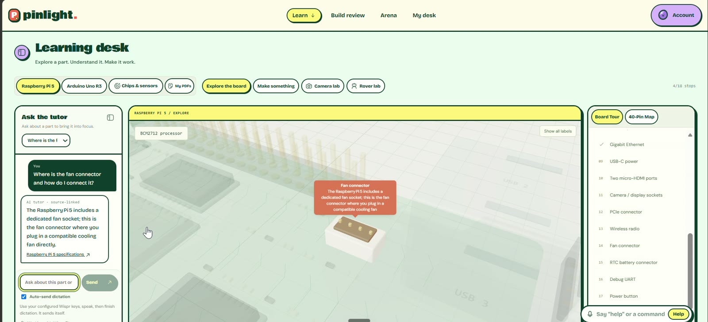

---

## Contents
- [The problem](#the-problem)
- [Not a prompt wrapper](#not-a-prompt-wrapper)
- [1. Learn](#1-learn--a-3d-learning-desk)
- [2. Build Review](#2-build-review--check-an-idea-before-you-buy-parts)
- [3. Your build in 3D + enclosure](#3-your-build-in-3d-with-an-enclosure-you-can-print)
- [4. Arena](#4-arena--explain-it-out-loud)
- [5. Personalised](#5-personalised)
- [6. Voice everywhere](#6-voice-everywhere)
- [Architecture](#architecture)
- [Open source we build on](#open-source-we-build-on)
- [Run locally](#run-locally)
- [Testing](#testing)
- [Honest limits](#honest-limits)

---

## The problem

Beginners ask an AI chatbot for a parts list and get a confident answer they can't check. Is the driver right for those motors? Does the 5 V sensor need level shifting before it touches a Raspberry Pi pin? What happens if you skip a part? At the shop, someone asks why you need it and you have no answer. Datasheets, pinouts, wiring guides and code all live in different places, and nothing checks whether you actually understood any of it.

Pinlight closes that loop:

```
 learn the part  →  review the idea  →  see it assembled  →  explain it back
   (3D desk)       (agents + rules)     (3D + enclosure)     (voice Arena)
        ↑                                                         │
        └──────────── weak topics become personalised practice ───┘
```

## Not a prompt wrapper

The language models are one component among many. Everything a model returns is **parsed, validated, repaired and rendered by deterministic code** that would still run if the model were swapped out:

| Layer | What the code does, without an LLM | Where |
|---|---|---|
| **Typed AI boundary** | Every agent output is parsed with Zod. Unknown part IDs, pins, evidence IDs and scene targets are dropped before they reach the UI. Free-form strings are normalised to known enums. | `server/review/*`, `server/arena/coach.js` |
| **Electrical rules** | Flags LEDs without series resistors, motors driven straight from GPIO, 5 V echo lines into 3.3 V pins, ultrasonic echoes needing a divider, missing grounds and pins the board doesn't have. Each wire gets a *checked* or *warning* status with a reason. | `shared/review/scene.js` |
| **Scene repair** | Rovers get exactly two TT drive motors on separate driver channels (OUT1/2 and OUT3/4), loose wheels are folded into the motors, implausible sizes fall back to real dimensions, the camera gets a ribbon to CAM/DISP, and wire IDs are renumbered to stay unique. | `normalizeScene`, `normalizeDrive` |
| **Form inference** | Regex and part analysis decide rover, arm, handheld, desk or box from the idea text, even if the model says otherwise. | `shared/review/assembly.js` |
| **Layout engine** | Per-form placement, decks, standoffs, links and mount rules (front, top, joint, hidden), with overlap-free packing and wires routed between named pin anchors. | `assemble`, `layoutScene` |
| **Solid geometry** | Enclosures are real CSG solids built in WebAssembly (manifold-3d), with openings cut where sensors, cameras and ports face outward, a lid lip, and binary STL and OpenSCAD exporters. | `shared/review/enclosure.js` |
| **Grading** | Arena answers are scored against fixed key points with keyword rules and a points formula. The model's per-point grade is schema-checked, with a keyword fallback when the model is unavailable. | `shared/arena/grading.js` |
| **Real time** | An in-memory room state machine (lobby → countdown → rounds → grading → finished), with SSE fan-out, heartbeats and client watchdogs. | `server/arena/rooms.js` |
| **Voice grammar** | A rule-based command parser that ignores dictation punctuation ("Help.") and filler, and detects "that's my answer" at the end of a dictation. | `src/lib/commands.js` |

**108 automated tests** cover these rules, the layout engine, enclosure generation, grading, the room engine, progress stats and the command parser.

---

## 1. Learn: a 3D learning desk

| | |
|---|---|
|  | 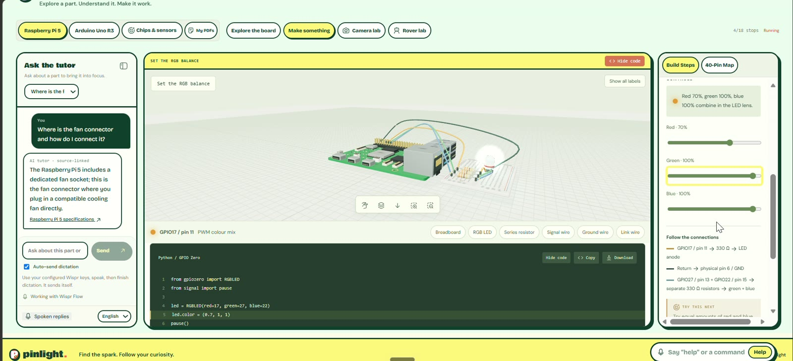 |
| *Ask "where is the fan connector?" and the camera flies to it* | *Guided activity: mix the RGB LED, with the code alongside* |

- **Raspberry Pi 5 and Arduino Uno R3** as selectable procedural 3D boards. The Pi has 18 board stops and a **40-pin inspector** that separates physical pin numbers from BCM GPIO numbers.
- **Guided activities** with live controls and matching Python (gpiozero) or Arduino code: *Blink an LED*, *Read a button*, *Set the RGB balance*, *Tune a piezo*, *Position a servo*, plus **Camera lab** and **Rover lab**. Each has a Copy and a Download button.
- **Ten chips and sensors** (TMP36, BMP280, SHT31, MPU-6050, HC-SR04, VL53L0X, NE555, LM358, 74HC595, MCP3008), each with a 3D body and four learning steps. They also have **20 board activities** that rebuild cables against named header pins, adding ADCs, level shifters and protection parts where the real circuit needs them.

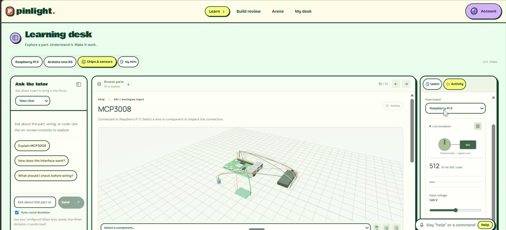

- **A source-grounded tutor.** Mastra orchestrates `gpt-oss-120b` on Groq. The server sends a bounded lesson snapshot and a strict output schema, then checks every returned evidence ID and component target before the scene moves. The browser can't inject its own prompt, and a curated guide is used when live AI is down.
- **PDF journeys.** Upload a datasheet and the pipeline builds a lesson from it:
  - **PDF.js** extracts text with coordinates;
  - **Tesseract.js** reads scanned pages;
  - **Docling** (optional) handles table layout;
  - citations and unsupported numbers are checked before anything is shown.

## 2. Build Review: check an idea before you buy parts

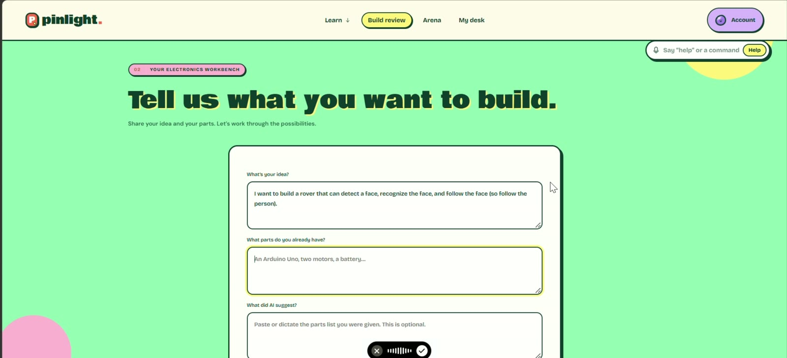

Speak your idea, the parts you already own and what another AI suggested. A multi-step pipeline **streams its progress over SSE**, and the button shows each step as it runs:

1. **Normalise the input** against a parts catalogue, working out which parts you own and which are missing (`shared/review/ownership.js`, `catalog.js`).
2. **Plan** with `gpt-oss-120b` and **review** with `gpt-oss-20b` as Mastra agents with tools, retrieving source evidence along the way.
3. **Five-branch possibility graph:** *you have these*, *you don't have these yet*, *if you add them*, *if you don't* and *alternatives you could use*, each tied to this specific idea.
4. **Requirements and checks**, plus a one-click **"Practise the concepts this build needs"**, which sends you into an Arena round built from the build's concepts.

| | |
|---|---|
| 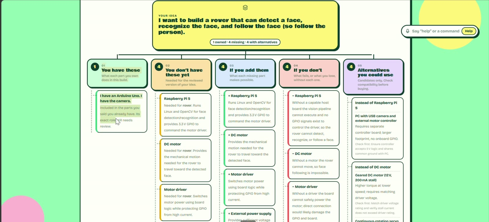 | 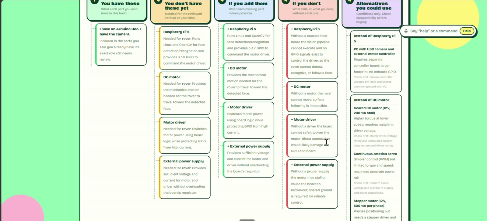 |
| *The idea at the root, with five branches* | *Each branch explains consequences, not just parts* |

## 3. Your build in 3D, with an enclosure you can print

A **scene agent** turns the reviewed build into parts, sizes, pins and connections. Then deterministic code takes over.

| | |
|---|---|
| 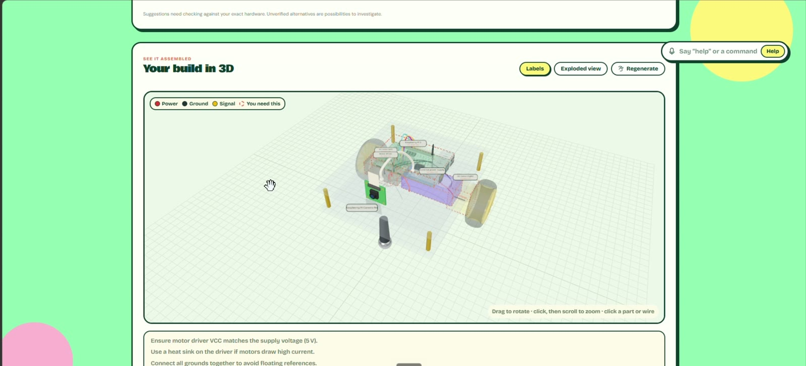 | 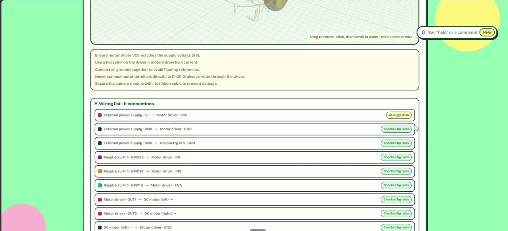 |
| *Workbench view: every part and wire, colour-coded by power, ground and signal* | *Every connection checked against the wiring rules* |

- **Form inference.** "A rover that follows a face" becomes a rover with a chassis, two TT motors and a caster, even if the model said "box".
- **Assembly engine.** Per-form placement with decks, standoffs, links and mount rules. Facing parts are never hidden, and arm servos become joints.
- **Procedural 3D parts** (`src/review/parts3d.js`). Boards, drivers, motors, wheels, ultrasonic sensors, cameras, servos, batteries and breadboards are all drawn in code with **three.js**, with no third-party model files. The boards are the same models the Learn desk uses (1 unit = 10 mm).
- **Three views:**
  - a workbench with every wire;
  - the inside of the assembly;
  - the **finished product**, with colour swatches.

  Each view uses OrbitControls, with click-to-zoom so the page still scrolls normally.

| | |
|---|---|
| 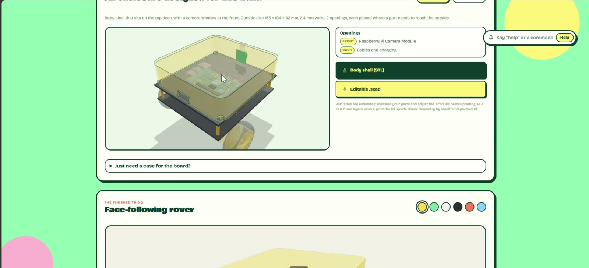 | 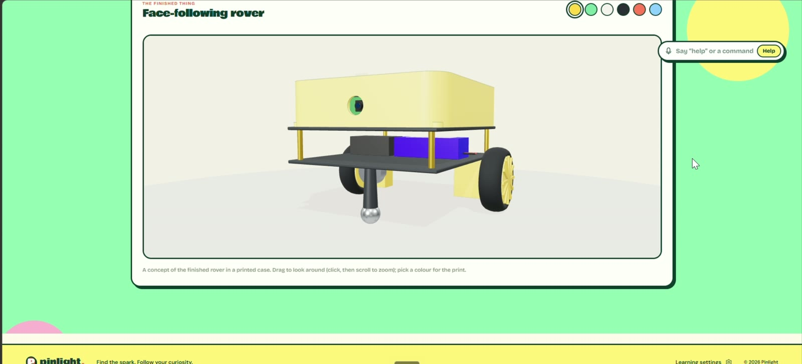 |
| *A project-specific enclosure with openings where parts face out* | *A preview of the finished product in your colour* |

- **Project-specific enclosure:**
  - a cover or box with a lid lip, sized around the assembly's bounds;
  - openings cut where cameras, ultrasonic sensors and ports face outward;
  - built as **CSG in manifold-3d (WebAssembly)**;
  - downloadable as **binary STL** for slicers and as **OpenSCAD** source for editing.
- **Board-only cases** for the Pi 5 and Uno are generated from the official mechanical drawings, with mounting holes and port cut-outs.

## 4. Arena: explain it out loud

| | |
|---|---|
| 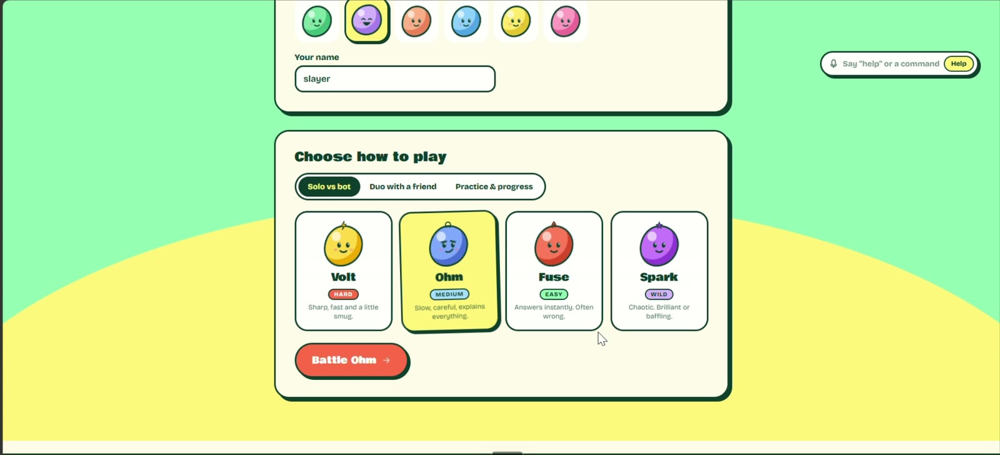 | 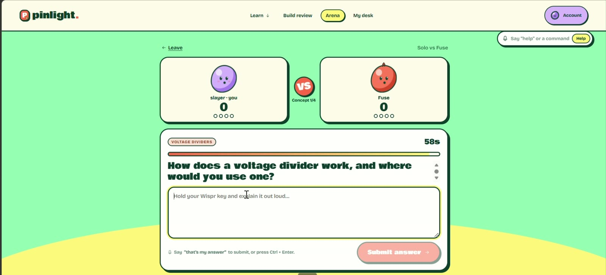 |
| *Solo against four personality bots, or live with a friend* | *60 seconds: speak, then say "that's my answer"* |

- **16 concepts across 4 tracks**, from Ohm's law to H-bridges. Each has fixed key points (with keyword sets), a reference answer, and strong, partial and weak bot answers.
- **Bots with personalities** (Volt, Ohm, Fuse, Spark). Each has its own accuracy odds and pacing: `planBotTurn` picks a delay and an answer variant, so the bots answer live while you speak.
- **Duo rooms** with a 5-character invite code. Scores update live over **server-sent events**: a `ping` heartbeat every 20 s, and a client watchdog that reconnects after 45 s of silence. Seat tokens never leave the server.
- **Four 60-second rounds.** Answers are submitted by voice: a regex detects *"submit"*, *"that's my answer"* or *"final answer"* at the end of the dictation and sends the answer. An empty dictation counts as a blank answer.
- **Scoring:** `points = accuracy × 10 + round(clarity × 4 × min(1, accuracy / 5)) + speed`. Clarity only counts when you're also accurate, so confident nonsense doesn't score.
- **AI grading and coach's verdict.** A Mastra grader returns structured per-point scores (Zod-validated), and the coach writes a verdict with the points you missed and the model answer.

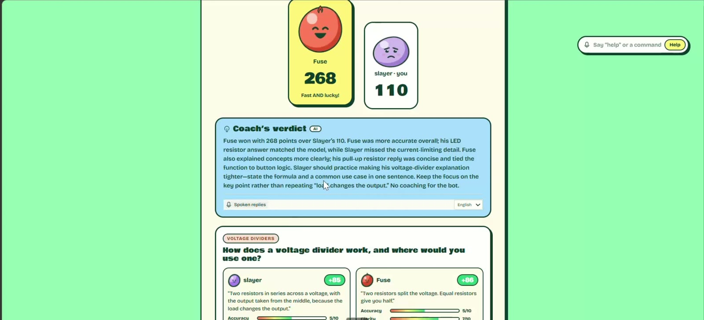

## 5. Personalised

| | |
|---|---|
| 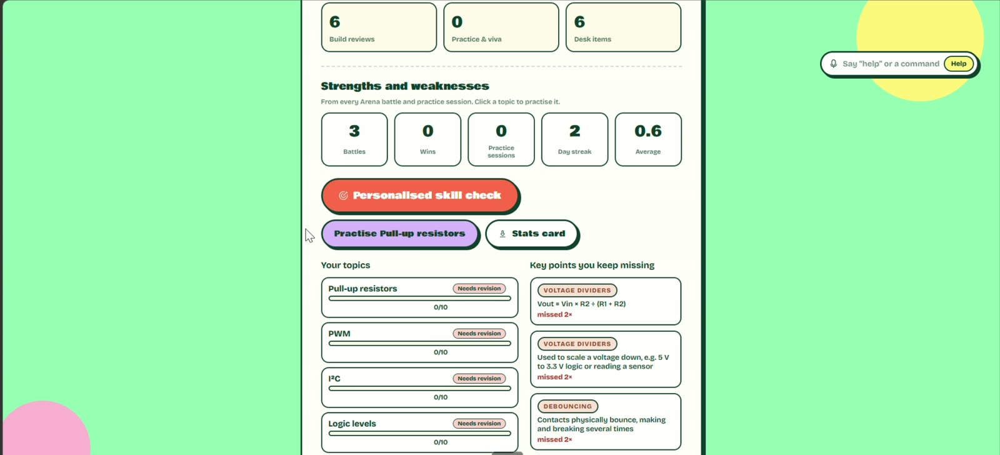 | 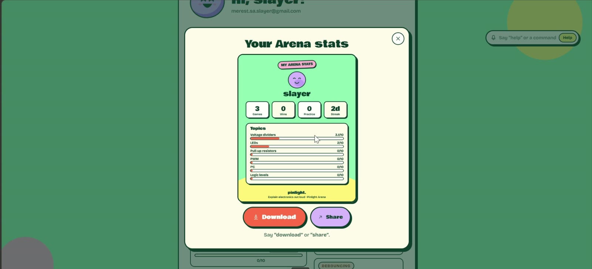 |
| *Strengths, weaknesses and key points you keep missing* | *A shareable stats card, inspired by Wispr Flow's usage card* |

- Every match is saved to your account (`arena_matches`, with row-level security). It tracks battles, wins, day streak, average and **mastery per topic**.
- **Personalised skill check** and **practice** go straight to your weakest topics (`planSkillCheck`, `weakestTopic`). The **concept map** colours the 16 ideas by how well you explain them, following the prerequisite tracks.
- **Share or download** stats and result cards, rendered to images in the browser.
- **My desk** keeps saved build reviews, learning items and chats. Guests can try everything; data is saved only when signed in.

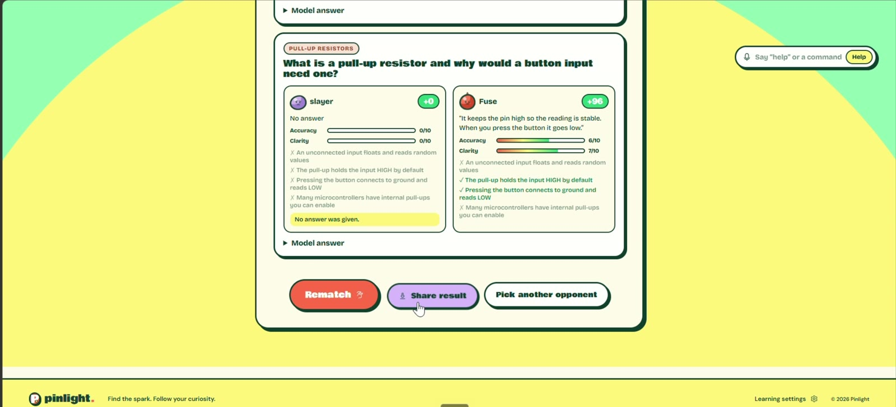

## 6. Voice everywhere
- **Wispr Flow** dictation goes into normal inputs. Auto-send fires when dictation finishes, so you never press Enter.
- **Voice command bar** under the account button. Say *"help"*, *"open arena"*, *"new build"*, *"concept map"*, *"share stats"*, *"start a battle"* or *"practise this"*. A rule-based parser strips dictation punctuation (keeping decimal points) and maps phrases to actions.
- **Desk commands:** *"next sensor"*, *"try activity with Arduino"*, *"set temperature to twenty-five"*, *"show connections"* and *"zoom in and show code"*. They're bounded and validated; anything else goes to the tutor.
- **Optional spoken replies** through Bolna: ElevenLabs English, Sarvam Hindi and Deepgram transcription for continuous listening. Sessions are consent-gated, and the voice bridge uses expiring capabilities.

---

## Architecture

```
┌──────────────────────── Browser · React 19 + Vite (Vercel) ────────────────────────┐
│ three.js scenes ─ learning desk · workbench · assembly · finished product           │
│ manifold-3d WASM ─ enclosure CSG → binary STL / OpenSCAD                            │
│ command parser · Wispr-aware inputs · SSE room client + watchdog · url-state         │
│ Auth0 SPA (refresh tokens) ──► audience-bound access token                          │
└───────────────────────────────────────┬────────────────────────────────────────────┘
                                        │ HTTPS · JSON · SSE
┌───────────────────────────── Node 24 API (Render) ─────────────────────────────────┐
│ zod-validated routes · per-IP rate limits · allow-listed origins · jose JWT verify │
│ Mastra agents on Groq                                                              │
│   tutor · planner (gpt-oss-120b) · reviewer (gpt-oss-20b) · scene agent · grader    │
│   └─ strict schemas · evidence checks · rate-limit-aware retry                     │
│ deterministic engines ─ wiring rules · form inference · assembly · grading         │
│ Arena rooms ─ in-memory state machine · SSE fan-out · 20 s heartbeats              │
│ PDF pipeline ─ PDF.js · Tesseract.js · Docling (optional)                          │
│ Bolna voice bridge ─ expiring capabilities                                         │
└───────────────────────────────────────┬────────────────────────────────────────────┘
                                        │ pg / supabase-js (service key, server only)
┌──────────────── Supabase Postgres · row-level security on owner_key ───────────────┐
│ build_records · arena_matches · learning items · chats · private document storage   │
└────────────────────────────────────────────────────────────────────────────────────┘
```

### Engineering details
- **Lenient in, strict out.** The scene schema accepts any string for shape, mount, role or kind, then normalises to known enums. A creative model output can't crash the renderer, and an unknown shape still renders as a sensible generic part.
- **Rate-limit resilience.** On Groq's free tier (about 8k tokens per minute), the scene agent reads the provider's suggested retry delay, waits up to 25 s and retries once. An in-flight map allows only one scene request per review, which also absorbs React StrictMode double mounts.
- **Geometry that agrees.** All shared code works in millimetres (1 three.js unit = 10 mm), so the 3D view, the assembly bounds and the exported STL describe the same object. Framing uses part bounds only, not the floor grid. Meshes use non-indexed geometry for clean flat shading.
- **Security:**
  - provider keys live only on the server;
  - owner keys come only from verified Auth0 tokens, and every query is scoped by owner, with RLS as a second wall;
  - room views omit seat tokens and owners;
  - record IDs, chat IDs and room codes are kept out of the address bar (`src/lib/url-state.js`, session-scoped);
  - 500 errors return generic messages.
- **Data model.** Migrations `0001` to `0005` cover desk items, learning artifacts, Auth0 ownership (`current_owner_key()`), build records and Arena progress, all with RLS policies.

---

## Open source we build on

             

| Project | What it does in Pinlight |
|---|---|
| **three.js** | Every 3D view: the learning desk, workbench, assembly, enclosure and finished product |
| **manifold-3d** | WebAssembly CSG engine that builds watertight enclosure solids in the browser |
| **React · Vite** | Interface and build |
| **Mastra** | Agent framework for the tutor, planner, reviewer, scene agent, grader and coach |
| **Zod** | Typed boundary on every AI response and API route |
| **PDF.js · pdf-lib · Tesseract.js · Docling** | Reading, rendering and OCR for datasheets |
| **KaTeX** | Maths in questions |
| **supabase-js · node-postgres** | Saved work and Arena progress |
| **jose · Auth0 SPA SDK** | Token verification and sign-in |
| **Hugeicons** | Icons |
| **Bowlby One · Bricolage Grotesque · DM Sans · Manrope** | Fonts (SIL OFL) |

**Reference data:**
- the official **Raspberry Pi 5 mechanical drawing** and **Arduino Uno Rev3 documentation**, for board dimensions and mounting holes;
- **EEE-Bench** (MIT), for practice questions.

**Hosted services:** Groq (`gpt-oss` open-weight models), Supabase, Auth0, Bolna (ElevenLabs, Sarvam, Deepgram), SerpApi, Vercel and Render.

Full licence details are in **[CREDITS.md](CREDITS.md)**. All 3D part models are drawn in Pinlight's own code; no third-party model files are shipped.

---

## Run locally

Requires **Node.js 24+**. Copy `.env.example` to `.env` (keep an existing one) and set the integrations you need. `GROQ_API_KEY` enables the live AI; without it, the desk uses its curated guide and Arena grading falls back to keyword rules.

```sh
npm install
npm run dev:api   # API on 127.0.0.1:4100
npm run dev       # in a second terminal → http://localhost:5173
```

**Accounts and saving.** Set `VITE_SUPABASE_URL`, `VITE_SUPABASE_ANON_KEY`, `VITE_ACCOUNTS=on` and the Auth0 values. Then apply `supabase/migrations/`, or run:

```sh
npm run migrate:learning
npm run migrate:review
npm run migrate:arena
```

These need a server-only `DATABASE_URL` (+ `DATABASE_SSL_CA`). To save build reviews and Arena progress, the API needs either `SUPABASE_URL` + `SUPABASE_SECRET_KEY`, or `DATABASE_URL`.

**Optional voice replies.** Set `BOLNA_API_KEY` and run `npm run configure:learning-voice`.

## Testing

```sh
npm test        # 108 tests
npm run build   # production frontend build
```

| Suite | Covers |
|---|---|
| `scene.test.js` | Pin validation, camera ribbon, wiring warnings, layout without overlaps, rover repair |
| `assembly.test.js` | Form inference, mounts and per-form placement |
| `enclosure.test.js` | Enclosure plans, CSG solids, STL and OpenSCAD output |
| `arena.test.js` | Room lifecycle, bots, scoring, spoken submit, duo and practice modes |
| `progress.test.js` | Match records, mastery, stats, skill-check planning |
| `commands.test.js` | Voice command parsing with dictation punctuation |
| `build-review.test.js` | Review pipeline contracts and storage |

Optional live checks (`npm run test:learning-live`, `npm run test:live`) need credentials and call real providers.

More detail: [Build Review notes](docs/build-review.md) · [PDF pipeline](docs/pdf-pipeline.md) · [Auth0 setup](docs/auth0-setup.md)

## Future work

### Build Review → a real build
- **Enclosures that fit like a product.** Add screw bosses that match each board's mounting holes, snap-fit lids, cable channels between decks, vents near motor drivers, and print-ready tolerances. Today the shell fits around the assembly's bounds; next it should be designed around each part.
- **Edit the build by voice.** *"Make the case 10 mm taller"*, *"move the camera to the top"*, *"swap the L298N for a TB6612"*. The scene is already structured data, so these become bounded edits followed by a fresh wiring check and enclosure rebuild.
- **Accurate part models.** Replace the procedural shapes with dimensioned models generated from licence-friendly sources such as the KiCad 3D libraries, so the enclosure openings line up with real connectors.
- **From review to working firmware.** Generate starter code (gpiozero / Arduino) from the checked wiring list, so the pins in the code always match the pins in the 3D view.
- **Simulate before you solder.** Export the circuit to a simulator such as Wokwi, run it, and feed the results back into the wiring checks.
- **Bill of materials.** One click turns "you don't have these yet" into a costed shopping list with alternatives.
- **Build journal.** Track a build from idea to finished product: photos, what changed, what broke, and what the review warned about.

### Continuous voice
- **Hands-free mode.** Keep listening after the first command, so you don't press a key for every sentence. Pause with *"stop listening"*, with a clear indicator and consent on every session.
- **Spoken Arena.** The coach reads out its verdict, and the bots answer aloud in duo spectator mode.
- **Talk back and forth with the tutor.** It speaks while the 3D board moves, and you can interrupt with *"wait, show me that pin again"*.
- **More languages.** Hindi voice replies already run through Sarvam; extend them to the tutor, the Arena questions and the grading.

### Arena
- **Rooms that survive restarts.** Move room state from memory to Redis or Postgres, so a redeploy or a free-tier sleep doesn't end a live match.
- **Classroom mode.** A teacher opens a room for a whole class, picks the concepts, and sees which key points the class keeps missing.
- **Adaptive difficulty and spaced repetition.** The next question depends on your mastery, and weak topics come back on a schedule instead of only when you ask for practice.
- **More concepts.** Go beyond 16: sensors, communication protocols, power design, and questions generated from your own build (with fixed key points reviewed before they go live).
- **Leagues and weekly challenges**, opt-in and shareable like the stats card.

### Learn
- **More boards:** ESP32, Raspberry Pi Pico and micro:bit, with their own pin inspectors and activities.
- **Identify a part from a photo.** Point the camera at a sensor or chip and the desk opens its lesson.
- **Live hardware mode.** Connect a real Pi or Arduino (Web Serial) and show its pin states on the 3D board.
- **Datasheet journeys with checks.** Turn any uploaded PDF into Arena questions about that part.

### Platform
- **Installable PWA** that works on phones and tablets, with cached lessons that work offline.
- **Accessibility pass:** full keyboard and screen-reader support for the 3D views, captions on spoken replies, and reduced-motion options.
- **A paid hosting tier** to remove the cold starts of the Render free tier.